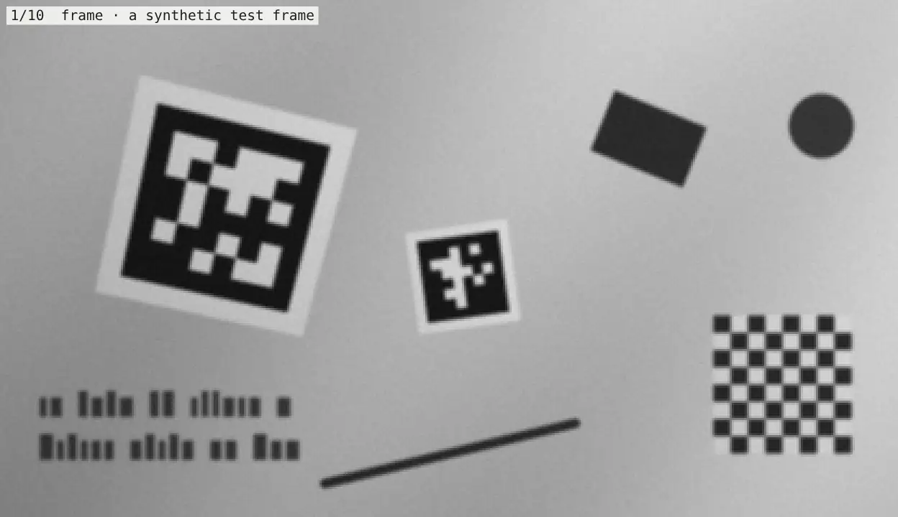

# Napa

**Not Another Pixel Algorithm**: Napa skips most of the pixels in each frame.

Napa is a fast AprilTag (`tag36h11`) detector for any camera. Give it a frame and it returns tag IDs and sub-pixel
corners, plus poses if you supply a calibration. It opens no cameras, starts no threads, and publishes nothing, so a
webcam, a Raspberry Pi, a headset, recorded video, or a camera SDK can all feed it the same way.

The detector is a small C library with no dependencies, plus a Python binding that needs only numpy.

## Compared with standard AprilTag

"Standard AprilTag" here means the upstream AprilTag 3 library at its default settings (`quad_decimate=2`). Both
detectors ran single-threaded on one pinned core of an Intel i7-12700H, taking turns on the same grayscale frames.

The benchmark has **3,000 distinct frames holding 5,521 tags**. Every frame is rendered separately, with random tag
IDs, positions, sizes, angles, 3D tilt, backgrounds, and camera degradations, and every tag has exact sub-pixel
ground truth. [The benchmark guide](benchmarks/README.md) describes each scene.

**Tags found.** Napa found **99.7%** of tags. Standard AprilTag found 86.2%, and AprilTag at full resolution
(`quad_decimate=1`) 99.4%. Napa finds the small tags that standard AprilTag's decimation loses, and of the 60
scene and resolution combinations, standard AprilTag found more tags than Napa in just one, by a single tag.

**Speed.** Napa was faster on every one of the 3,000 frames:

- **Noise-free frames: 5.4× to 10× faster** (median per frame, by resolution). The slowest single frame was still
  4.4× faster.
- **Realistic frames: about 22× faster** (median). Every other scene includes at least light sensor noise
  (σ ≈ 1.5 grey levels), which a real sensor always has. Standard AprilTag's time climbs steeply with noise: on a
  1280×720 frame it takes about 1.2 ms with none, 8 ms at σ = 1, and 13 ms at σ = 1.5. Napa stays near 0.2 ms.
  The slowest single frame here was 3.5× faster.
- Against AprilTag at full resolution, Napa was 98× faster (median) and at least 10× faster on every frame.

These are the 1280×720 results; the guide has every resolution:

| Scene, 1280×720 | Tags | AprilTag | Napa | Speedup (median) | Slowest frame | Tags found (AprilTag → Napa) |
| --- | ---: | ---: | ---: | ---: | ---: | ---: |
| Noise-free | 104 | 1.58 ms | 0.19 ms | 9× | 7.0× | 104 → 104 |
| One tag | 50 | 15.2 ms | 0.19 ms | 78× | 59× | 50 → 50 |
| 2–12 tags | 354 | 11.2 ms | 0.61 ms | 18× | 7.3× | 354 → 354 |
| Small tags (32–53 px) | 120 | 13.6 ms | 0.30 ms | 45× | 11.5× | 0 → 120 |
| Large tags | 50 | 12.3 ms | 0.38 ms | 42× | 13.8× | 50 → 50 |
| Steep angle (40–65°) | 112 | 12.1 ms | 0.35 ms | 33× | 11.8× | 109 → 108 |
| Defocus blur | 89 | 11.5 ms | 0.33 ms | 33× | 8.7× | 89 → 89 |
| Motion blur | 94 | 11.3 ms | 0.43 ms | 17× | 8.6× | 94 → 94 |
| Heavy noise (σ 4–14) | 104 | 10.9 ms | 0.65 ms | 19× | 5.3× | 104 → 104 |
| Uneven lighting | 103 | 12.5 ms | 0.40 ms | 32× | 11.6× | 103 → 103 |
| Low contrast | 100 | 15.4 ms | 0.22 ms | 70× | 44× | 95 → 99 |
| Underexposed | 99 | 12.5 ms | 0.33 ms | 39× | 13.1× | 99 → 99 |
| Overexposed | 112 | 2.08 ms | 0.26 ms | 7× | 4.9× | 112 → 112 |
| JPEG artefacts | 100 | 2.99 ms | 0.29 ms | 9× | 4.0× | 100 → 100 |
| Busy background | 87 | 12.1 ms | 0.31 ms | 40× | 10.7× | 87 → 87 |
| At the frame edge | 105 | 12.2 ms | 0.32 ms | 37× | 12.2× | 103 → 105 |
| Dark background | 105 | 12.0 ms | 0.27 ms | 44× | 12.5× | 91 → 105 |
| No tag: empty / clutter / decoys | — | 11–17 ms | 0.09–0.35 ms | 19–164× | 5.0× | — |

Times are the median detector call. Speedups are per frame: AprilTag's time divided by Napa's on the same frame.
"Slowest frame" is the smallest of those ratios.

**Corners.** For each tag, the benchmark measured the worst corner's distance from the true corner. On the 4,750
tags both detectors found, Napa's median error was **0.019 px** against AprilTag's 0.099 px, and its 95th percentile
**0.088 px** against 0.302 px. Napa was more accurate at the median and 95th percentile in every scene. The exception
is the single worst case under heavy motion blur: with 11 px of blur on a tag about 50 px across, one of Napa's
corners was 2.5 px off, where AprilTag's worst in that scene was 0.98 px.

**False detections.** In 3,000 frames, Napa reported one wrong ID: a tag-shaped decoy whose random payload happened
to fall within 2 bits of a real code, the same tolerance standard AprilTag uses. Standard AprilTag reported none,
and full-resolution AprilTag 3. On a separate test of 80,000 such decoys, Napa reported none.

These are synthetic frames on a desktop CPU. Measure on your own camera and hardware before relying on a specific
number: `napa-benchmark` scores Napa on your own annotated images (see [the guide](docs/guide.md)).

## Why it's faster

Standard AprilTag treats each frame as a large image-processing job. It thresholds every pixel, segments the whole
image into regions, and fits quadrilaterals to every region's boundary before it asks whether anything is a tag.
Napa asks that question as early and as cheaply as it can.



*One synthetic frame, stage by stage. Every overlay is computed from the frame by a port of Napa's pipeline.*

### 1. The rake: sample sparsely, with a guarantee

A tag's black border is one cell wide, and a tag is 8 cells across. Sample every few pixels and you're guaranteed to
land on the border of every tag above a minimum size, so skipping the pixels in between can't skip a tag.

Napa drags a "rake" across the frame, taking one sample every ¾ of the smallest cell in each direction. Blur greys a
cell's edges but leaves its core dark, and ¾-cell spacing always puts a sample in that core. For the default 32 px
minimum tag, that's one pixel in nine. Coarser copies of the rake (2×, 4×, 8×, …) catch larger tags; each is built
from the one before, not from the image, and together they add only a third again to the cost.

Each tag is handled at the level where it's between about 16 and 64 samples across. Below that, its one-cell white
margin can fall between samples and the tag merges with a dark background; above it, the middle of its border is
too far from any white to stand out. Every tag size has such a level.

### 2. String search on a matrix: skip what can't match

Fast string search (Boyer–Moore) doesn't compare every character. One cheap check can prove that no match starts in
the next several positions, so the search jumps past them.

Napa applies the same idea to the image. It splits the raked samples into small tiles and records each tile's
darkest and brightest value. A tile without contrast can't contain a tag's edge, so Napa skips it and does no work
on its pixels. The contrast needed rises automatically with sensor noise, measured from the frame itself, which is
why noise barely changes Napa's time.

The same idea speeds up decoding. A tag's 36 payload bits must be matched against 587 codes in 4 rotations, allowing
up to 3 wrong bits. Any code within 3 bits of the payload must match at least one of four 9-bit blocks *exactly* (the
pigeonhole principle). So Napa looks those blocks up in a table and compares only the handful of codes that share
one, instead of all 2,348.

### 3. Old-school vector math

Every pass over the samples is written as whole-row vector operations, the classic Apple AltiVec/vDSP approach. One
SSE2 or NEON instruction compares 16 samples with their thresholds and packs the results into a bit mask. Runs of
dark samples then fall out of the masks with a count-trailing-zeros instruction per run, not a test per pixel.
Runs that touch from row to row are joined into blobs with union-find, so the cost follows the number of runs, not
the number of dark pixels. Gathering every third pixel uses a byte shuffle (SSSE3, chosen at run time) or NEON's
de-interleaving load.

### 4. Reject early, measure carefully

Each blob of plausible size gets a rough quadrilateral from its extreme points. A blob can't be a tag if it's darker
overall than any real code allows: every tag36h11 code has at least 10 white cells. Then Napa:

1. Fits each side to its edge at full resolution.
2. Decodes straight away with a loose tolerance, reading the border first. Text, texture, and checkerboards are
   thrown out here, before any expensive refinement.
3. Refines each side coarse to fine, then with a final pass that measures the edge every 1.5 px along it. Each
   measurement is the centre of the edge's gradient, which is exact for real, pixel-integrated edges. Where blur is
   wider than about half a cell, the edge is located instead where the image crosses halfway between the black and
   white on either side.
4. Intersects the four lines to get the corners, and decodes the payload.

Some images fool a plain edge fit, so Napa checks for them:

- **A grey quiet zone on a bright background** makes the margin look dark, so the first outline is the margin's.
  If the decode fails, Napa tries the outline's inner 8/10, where the black square would be.
- **A side fitted one cell out**, on the margin's outer edge, shows up as border cells that read white. Napa moves
  that side in by a cell and refits it.
- **Clipped (saturated) exposure** shrinks every black region by the same amount. The black border must be exactly
  one cell wide, so Napa measures that shrinkage on the tag itself and undoes it.

## Obstructions

Napa corrects up to 3 wrong payload bits (standard AprilTag defaults to 2), so a hand, cable, or glare spot over part
of a tag often still decodes. It accepts a third corrected bit only when the three wrong cells touch, as they do
under a real obstruction: a random pattern that happens to fall within three bits of a code has its errors
scattered, so this keeps chance matches out. In the benchmark's obstruction sweep (864 tags, each partly covered by
a white or grey patch), Napa recovered 356 tags and standard AprilTag 330.

No AprilTag detector can find a tag whose black border or corners are hidden, because the border is found before any
bits are read. Obstruction tolerance is best-effort, with no guaranteed percentage.

## Limits

- Tags smaller than `min_tag_px` (default 32 px across the black square) may be missed. Lower it to find smaller tags,
  at some cost in speed. A steeply tilted tag counts by its narrowest side.
- Tags need their white quiet zone, as printed tags have.
- Motion blur longer than a cell (an eighth of the tag) is the hardest case for corner accuracy: most corners stay
  within a tenth of a pixel, but the worst can be off by a few pixels.
- Installing needs a C99 compiler, since Napa is its C core.

## Quick start

Requires Python 3.11 or newer and a C compiler.

```bash
python -m pip install -e .              # the detector: needs only numpy
python -m pip install -e ".[headless]"  # adds OpenCV, for poses, calibration, and napa-benchmark
```

```python
from napa_vision import NapaDetector

detector = NapaDetector()
for tag in detector.detect(image):  # uint8 grayscale, BGR, or BGRA
    print(tag.tag_id, tag.corners)
```

For metric poses, use `VisionProcessor(calibration=load_calibration_data("camera.json"), tag_size_m=...)`. Use one
detector per camera stream. The native call releases the GIL, so separate streams can run on separate threads.

The C library has a plain C API (`src/napa_vision/_native/napa_core.h`), so other languages can call it directly.
[The guide](docs/guide.md) covers tuning, poses, coordinate conventions, and calibration.

## Command-line tools

| Command | Purpose |
| --- | --- |
| `napa-calibrate` | Measure camera intrinsics from checkerboard photographs |
| `napa-benchmark` | Score Napa on your own annotated images, with optional recall, precision, and latency gates |

## Development

```bash
python -m pip install -e ".[headless,dev,benchmark]"
ruff format --check . && ruff check .
pytest --cov=napa_vision
```
