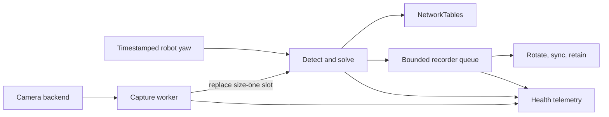
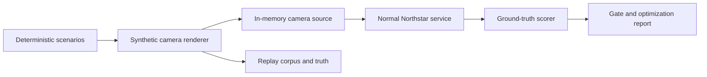

# Northstar Vision

`northstar-vision` is an alpha AprilTag 36h11 service for FRC-style coprocessors. It keeps camera latency bounded with
a latest-frame capture worker, detects tags with OpenCV, rejects weak field poses, publishes the upstream Northstar
NetworkTables packet, and can record complete frame results without putting disk I/O on the processing path.

Version 0.3.0 is an unreleased hardening release. The repository does not yet declare a redistribution license, so do
not publish its wheel or source archive until the owner chooses one.

## Install

Python 3.11 or newer and OpenCV 4.7 or newer are required.

```bash
python3 -m venv .venv
source .venv/bin/activate
python -m pip install '.[gui]'
```

For a coprocessor or CI host without a display server, install the mutually exclusive headless backend instead:

```bash
python -m pip install '.[headless]'
```

Choose exactly one OpenCV extra. The headless build supports detection, replay, calibration, and simulation, but not
`northstar-vision --show`; use the `gui` extra anywhere the debug window is required.

Install RobotPy NetworkTables support on a coprocessor with:

```bash
python -m pip install '.[gui,nt]'
```

The package provides five commands:

```text
northstar-vision      run the camera or replay service
northstar-calibrate   measure intrinsics from checkerboard images
northstar-layout      validate a WPILib AprilTag field layout
northstar-benchmark   measure an annotated image corpus and enforce gates
northstar-simulate    generate and score deterministic camera-free scenes
```

## Quick start

Validate a profile without opening a camera:

```bash
northstar-vision --list-profiles
northstar-vision --profile laptop --check-config
```

Run a laptop camera with a debug window, or replay a video/image directory once:

```bash
northstar-vision --profile laptop --show
northstar-vision --profile laptop --replay path/to/frames --output none
```

The `raspi` profile defaults to NetworkTables output:

```bash
northstar-vision --profile raspi
```

The bundled profiles are development examples. Their intrinsics, camera mount, and field layout are synthetic and
must not be used for robot localization.

## Runtime flow



Only the capture worker owns `VideoCapture`. If processing falls behind, a new frame replaces the stale slot instead
of growing a backlog. Failed opens and reads reconnect with bounded exponential backoff. Health includes captured,
delivered, overwritten, disconnect, reconnect, requested-property, negotiated-property, backend, FourCC, and shutdown
counters. A negotiated resolution that does not match the calibration is fatal.

Some OpenCV camera backends can block inside their native `read()` implementation. Shutdown remains bounded from the
caller's perspective and reports a timed-out worker, but Python cannot forcibly interrupt that native call; validate
the chosen V4L2/backend behavior on the target camera.

## Embedding in other systems

`VisionProcessor` processes images supplied by your application, without opening cameras, reading a platform profile,
publishing results, or starting threads. Use one instance per camera stream; the number of cameras is unrestricted.
The existing camera service uses this same processor and owns capture, output, and device health separately.

```python
from northstar_vision import VisionProcessor

processor = VisionProcessor()
# image is a caller-supplied NumPy uint8 grayscale, BGR, or BGRA frame.
result = processor.process(image, timestamp=frame_timestamp_s)
for tag in result.image_observations:
    print(tag.tag_id, tag.corners)
```

Detection alone needs neither calibration nor a field layout. To enable metric poses, supply an existing calibration
artifact and the physical tag size:

```python
from northstar_vision import load_calibration_data

processor = VisionProcessor(
    calibration=load_calibration_data("camera-calibration.json"),
    tag_size_m=0.1651,
)
```

Calibrated frames must match the calibration resolution. Each result includes tag-relative IPPE candidates and angles;
optional `tag_layout` enables the existing field pose. Robot mounting and yaw augmentation remain in the FRC service.
Coordinate conventions remain those documented below: tag-relative IPPE vectors use OpenCV axes, while field and robot
poses use WPILib axes. Applications must explicitly convert these to their own world coordinates.

Pass a `detector=` object implementing `FiducialDetector.detect(image) -> list[FiducialImageObservation]` to replace
the detection algorithm. Backends must preserve original tag IDs and return independent, finite `4x2` corner arrays
in the input image's pixel coordinates and the existing OpenCV AprilTag corner order, including decoded rotation.
They must not mutate or retain the input image. Optional prefiltering belongs in that backend. The archived custom
detector needs a corner-order adapter and validation before it can be used for calibrated poses through this interface.

Calls are synchronous and must not overlap on one processor. The application owns image buffers, camera permissions,
RGB/YUV conversion, orientation, scheduling, and result delivery. Strided NumPy images are accepted. Frame timestamps
and optional `capture_monotonic_s` are supplied in seconds by the caller; the processor never subtracts device clocks.
Empty detections return a normal result, while invalid inputs and backend failures raise to the caller.

This is device-independent **Python** integration. Running the same implementation locally from C#, C++, or an Android
application requires a shared native library and language bindings; those are not implemented here yet. The
[portability plan](.plans/2026-10-16_device_agnostic_vision.html) defines that next step without tying it to a particular
headset or camera SDK. Recursive coarse-to-fine scanning also remains a benchmark candidate, rather than a default.

## Production calibration and field layout

Capture checkerboard photographs at the exact deployed resolution, focus, and lens settings. Use varied positions and
angles, then create a versioned measured artifact:

```bash
northstar-calibrate calibration-images/ \
  --output deploy/camera-calibration.json \
  --columns 9 --rows 6 --square-size-m 0.024 \
  --minimum-views 12
```

Validate the official WPILib layout and record its authoritative source:

```bash
northstar-layout deploy/field-layout.json \
  --official-source "WPILib official season layout" \
  --require-production \
  --report deploy/field-layout-report.json
```

Reference both artifacts from an external profile using paths relative to that profile:

```json
{
  "schema_version": 1,
  "name": "competition-camera",
  "device_id": "northstar_0",
  "platform": "raspberry_pi",
  "production": true,
  "camera": {
    "id": 0,
    "width": 1280,
    "height": 720,
    "fps": 30,
    "buffer_size": 1,
    "calibration": {"file": "camera-calibration.json"},
    "robot_to_camera": {
      "translation_m": [0.25, 0.0, 0.35],
      "rotation_rpy_rad": [0.0, 0.0, 0.0]
    }
  },
  "tag_size_m": 0.1651,
  "tag_layout": {
    "wpilib_json": "field-layout.json",
    "provenance": {"kind": "official", "source": "WPILib official season layout"}
  },
  "detection": {},
  "output": {"mode": "nt", "nt_server": "10.0.0.2"}
}
```

Strict parsing rejects unknown fields, duplicate tag IDs, invalid matrices, mismatched calibration resolution, and
invalid thresholds. A `production: true` profile additionally requires measured calibration provenance with view/error
metrics and official layout provenance with field dimensions.

All field and mounting transforms use WPILib axes: +X forward, +Y left, +Z up, and positive yaw counter-clockwise from
above. `camera.robot_to_camera` is the camera pose in the robot frame. The tag face lies in local Y/Z and local +X is
its face normal.

The corner convention matches official AprilRobotics/FRC artwork and upstream Northstar. OpenCV's
`generateImageMarker()` raster is rotated 180 degrees relative to that artwork. When warping into the ordered points
returned by `tag_field_corners()`, map the unrotated raster TL/TR/BR/BL directly to corners 0/1/2/3; that destination
order already accounts for the artwork convention. Do not add a second 180-degree rotation without also remapping
the destination corners.

## Pose quality

Single-tag localization preserves both IPPE ambiguity candidates and suppresses the field pose if either candidate
fails reprojection or physical-bound checks. Multi-tag solving uses RANSAC when at least three tags are available,
falls back to a physically valid general PnP solve, removes high-residual tag outliers iteratively, and validates field
and camera-height bounds.

JSONL output records attempted, accepted, and rejected tag IDs, per-tag and overall RMS reprojection error, RANSAC use,
iterations, and the final rejection reason. Raw image/tag-angle observations remain available even when a field pose is
rejected. The existing `confidence` value is only a display heuristic; pose acceptance does not use it.

## NetworkTables and robot yaw

The service publishes to `/<device_id>/output` using the upstream topic names. `observations` carries the frame's
capture timestamp translated into NetworkTables synchronized monotonic time, followed by additional `fps_apriltags`,
`latency_ms`, and `health` topics.

Delivery semantics are explicit:

```bash
# Preserve every update for upstream compatibility.
northstar-vision --profile raspi --nt-delivery upstream

# Prefer the newest value when intermediate frames are disposable.
northstar-vision --profile raspi --nt-delivery latest
```

Shutdown flushes pending topics and allows a bounded 100 ms drain by default so short runs do not discard their final
observation. Configure that budget with `output.nt_close_drain_s` or `--nt-close-drain`.

Trig localization is suppressed by default because a timeless heading is unsafe. Subscribe to an absolute
NetworkTables double topic in radians to buffer timestamped samples, interpolate across angle wrap, and align yaw to
frame capture time:

```bash
northstar-vision --profile raspi \
  --robot-yaw-topic /RobotState/yaw \
  --yaw-max-age 0.10
```

`--robot-yaw` remains available only for controlled bench tests. Stale or unavailable samples produce no trig pose and
are visible in health telemetry. The robot-side yaw publisher must enable duplicate delivery (`keepDuplicates=True`,
normally with `sendAll=True`) or publish a changing heartbeat contract. A default publisher can suppress repeated
stationary headings; those samples then age out deliberately even while NetworkTables remains connected.

## Bounded JSONL recording

JSONL contains corners, both single-tag candidates, field-pose candidates, tag angles, trig poses, pose diagnostics,
quality data, timings, and output health. The async writer has a fixed queue, configurable drop policy, size/time
rotation, archive retention, periodic flush/fsync policy, bounded close, and write/drop/error telemetry.

```bash
northstar-vision --profile laptop --output jsonl \
  --output-path recordings/run.jsonl \
  --jsonl-queue-size 256 \
  --jsonl-drop-policy drop_oldest \
  --jsonl-max-size-mib 64 \
  --jsonl-rotate-seconds 3600 \
  --jsonl-retention-files 8 \
  --jsonl-fsync-interval 5
```

Use `0` to disable size rotation, time rotation, or periodic fsync through their corresponding CLI options. The active
file is not counted in `retention-files`.

## Hardware-free simulation

Generate deterministic AprilTag scenes and run them through the same detector, single-tag solver, multi-tag solver,
health collection, and service orchestration used by a real camera:

```bash
northstar-simulate --profile laptop --suite standard \
  --repetitions 5 --compare-optimizations \
  --output-dir reports/synthetic --pretty
```

The standard suite covers clean and oblique views, blur/noise, dark motion-compressed input, partial occlusion, a
layout outlier, single-tag ambiguity, and a blank frame. The `sweep` suite moves the synthetic camera through 31
poses. The command gates ID recall/precision, ordered-corner error, pose solve rate, translation/rotation error, and
outlier rejection. It also reports render, detection, solve, and total processing percentiles.

Generated artifacts include a strict replay `corpus.json`, `ground-truth.json`, a compatible
`simulation-profile.json`, PNG frames, and `simulation-report.json`. They can exercise either supported workflow:

```bash
northstar-vision --profile reports/synthetic/simulation-profile.json \
  --replay reports/synthetic/frames --output none
northstar-benchmark reports/synthetic/corpus.json --repetitions 5
```

With `--compare-optimizations`, the report measures ArUco3, a dictionary restricted to the synthetic field layout,
subpixel corner refinement, and skip-scan against identical seeded frames. A candidate is only marked for hardware
follow-up when its gates, accuracy, and pose solve counts match, plus it improves median processing by at least 5% or
p95 by at least 20% without regressing median by more than 10%. This comparison does not change the production detector
configuration, and synthetic results do not qualify a candidate for deployment without physical-camera validation.



Simulation is deliberately labeled synthetic evidence. It can validate software behavior and regression safety now,
but it cannot validate a physical lens/calibration, exposure or rolling shutter, USB reconnects, Raspberry Pi thermal
performance, or radio/NetworkTables timing.

## Replay benchmark

Copy `benchmarks/corpus.example.json`, place annotated images beside it, and freeze each image with an optional SHA-256.
Manifest paths must stay beneath the manifest directory. The command streams frames and reports recall, precision,
false positives/negatives, bounded mismatch samples, peak decoded image size, and p50/p95/p99 load, detection, scoring,
and total time.

```bash
northstar-benchmark benchmarks/pi-corpus.json \
  --repetitions 5 --warmup-passes 1 \
  --min-recall 0.99 --min-precision 1.0 \
  --max-p95-total-ms 30 \
  --output reports/pi-benchmark.json --pretty
```

An input/configuration error exits `2`; a failed performance/accuracy gate exits `1`. Keep skip-scan disabled unless a
representative Raspberry Pi corpus shows recall parity and a useful percentile improvement over full-frame detection.

Use the opt-in replay comparison to evaluate ArUco3 or a field-layout-only dictionary on the same decoded images:

```bash
northstar-benchmark benchmarks/corpus.json \
  --compare-detectors aruco3 layout-restricted \
  --layout-tag-ids 1,2,3,4 --max-decoded-cache-mib 256 \
  --repetitions 5 --warmup-passes 1 --output reports/detector-comparison.json
```

The restricted candidate remaps compact dictionary rows back to the supplied original tag IDs and intentionally ignores
all other tags. Comparison mode reports detection-only speedups, its fixed execution order, and retained decoded-cache
bytes. The cache has a 256 MiB default ceiling; split a larger corpus into representative shards or raise the limit
explicitly. Both candidates remain hardware-validation inputs and never alter the production detector default.

## Development and packaging

```bash
python -m pip install -e '.[headless,dev,nt]'
ruff format --check .
ruff check .
pytest --cov=northstar_vision
python -m build
python -m twine check dist/*
```

CI covers Python 3.11–3.14, OpenCV 4.7 on Python 3.11, the current OpenCV release, real local NetworkTables timestamp
integration, the deterministic simulator, and fresh wheel/sdist command smoke tests. The package includes typed
source, bundled example profiles, and all five command entry points. The source archive also includes the benchmark
manifest template and changelog.

Unsupported occlusion-tolerant research remains under `experiments/occlusion_detector/` and is excluded from wheels
and source distributions. Deprecated ArUco calls, legacy launchers, and the obsolete synchronous JSONL writer are not
part of the supported runtime.

## Remaining release gates

- Choose a redistribution license and provide author, maintainer, repository, and release-policy metadata.
- Capture measured camera calibration and select the official season layout for the actual robot.
- Build and run a representative Raspberry Pi corpus; choose team-owned recall, pose-error, and latency budgets.
- Validate camera reconnect, pose accuracy, robot-side timestamp behavior, and delivery policy on real hardware/radio.
- Complete an eight-hour Raspberry Pi soak with thermal, RSS, queue, disk-growth, and frame-age evidence.
