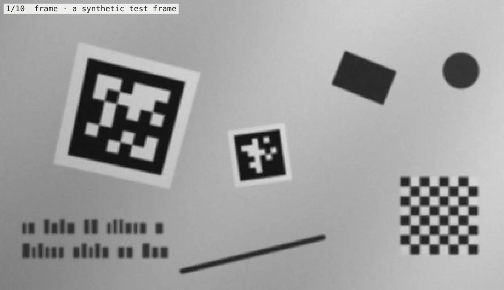

# NAPA

NAPA is an AprilTag detector. It samples a sparse grid of pixels to find likely tags, then does full-resolution work
only on the tags themselves. Give it a frame and it returns tag IDs and sub-pixel corners. Give it a camera
calibration and it also returns poses, each with a covariance.

NAPA reads all nine AprilTag families. The default is tag36h11, the family FRC has used since 2024. Detection needs
only NumPy. Poses and calibration need OpenCV.

```bash
python -m pip install napa-vision          # detection
python -m pip install "napa-vision[headless]"  # detection + poses
```

Requires Python 3.11 or newer.

## Quick start

```python
from napa_vision import NapaDetector

detector = NapaDetector()
for tag in detector.detect(frame):  # uint8 greyscale, BGR, or BGRA
    print(tag.tag_id, tag.corners)
```

For poses:

```python
from napa_vision import VisionProcessor, load_calibration_data

processor = VisionProcessor(
    calibration=load_calibration_data("camera.json"),
    tag_size_m=0.1651,
    tag_layout=layout,  # {tag_id: field_to_tag}, for a camera pose on the field
)
result = processor.process(frame, timestamp=capture_time)
```

Code written for `pupil_apriltags` or `dt-apriltags` keeps working with one import changed:

```python
from napa_vision.compat import Detector  # was: from pupil_apriltags import Detector
```

## How it compares

The [benchmark](benchmarks/README.md) runs every detector on the same 3,000 rendered frames (5,521 tags at 640x480,
1280x720, and 1920x1080, with exact ground truth), single-threaded on one core of an Intel i7-12700H. NAPA ran at
`min_tag_px=32`, the default when this was measured. The current default is 22, which finds smaller tags and costs
about 1.2x as much time. See [Choosing settings](docs/detection.md#choosing-settings).

| Detector | Speed vs WPILib defaults (median frame) | Tags found | Worst-corner error (median) | Wrong IDs |
| --- | ---: | ---: | ---: | ---: |
| NAPA, `min_tag_px=32` | 25x | 99.9% | 0.020 px | 1 |
| AprilTag, WPILib defaults | 1x | 86.2% | 0.099 px | 0 |
| AprilTag, decimate 2 | 0.79x | 99.7% | 0.043 px | 3 |
| AprilTag, full resolution | 0.21x | 99.9% | 0.042 px | 3 |
| Locus | 1.3x | 97.7% | 0.044 px | 1 |
| Locus, decimate 2 | 2.4x | 98.2% | 0.044 px | 1 |
| OpenCV ArUco, subpixel | 0.55x | 99.4% | 0.289 px | 1 |
| ArUco3 | 1.2x | 97.8% | 0.986 px | 1 |
| ArUco3, tags over 64 px | 3.1x | 80.0% | 0.282 px | 0 |
| ArUco3, tags over 32 px | 2.2x | 96.1% | 0.284 px | 1 |
| ArUco Nano | 4.8x | 99.9% | 0.044 px | 0 |
| RapidTag, subpixel | 2.0x | 75.5% | 0.294 px | 19 |

Notes on the table: NAPA was fastest on all 3,000 frames (smallest lead over ArUco Nano: 1.8x on one frame). Its one
wrong ID was a random-pattern decoy. The lead grows with resolution: 18x at 640x480, 36x at 1280x720, 74x at 1920x1080
against WPILib defaults.

Range: NAPA at `min_tag_px=32` found every tag from 22 px up, vs 80 px for WPILib defaults and 14 px for AprilTag at
full resolution. Same camera, about 3.6x the range of WPILib defaults. At `min_tag_px=16` it found everything down to
12 px, at ~3x the cost.

Corners: within 0.09 px on 95% of tags. Heavy motion blur is the exception (worst 3.4 px vs 2.2 px for full-resolution
AprilTag).

Also in the [benchmark guide](benchmarks/README.md): 96-100% found on 600 stress frames, and tag16h5 results where
AprilTag's default correction produced 581 wrong IDs to NAPA's zero.

The frames are synthetic and the timings come from one laptop CPU. Before you rely on any number here,
[score NAPA on your own footage](docs/measuring.md). The
[full report](benchmarks/results/2026-10-30_cpu_full_corpus/report.md) has every configuration's settings, latency
percentiles, and per-scene tables.

## How it works



[How NAPA works](docs/how-it-works.md) walks through each stage, plus what blocks it: a hidden border, a missing
quiet zone, and motion blur longer than one cell.

## Documentation

- [Examples](examples/README.md). Runnable scripts. Start with the one that needs no camera.
- [Detection](docs/detection.md). Choosing settings, tuning, families, printing tags, and switching from
  `pupil_apriltags`.
- [Poses and filters](docs/poses.md). Metric poses, covariances, WPILib pose estimators, and rolling-shutter cameras.
- [Camera calibration](docs/calibration.md). Measuring a camera with a checkerboard.
- [Stereo rigs](docs/stereo.md). One pose from two calibrated cameras.
- [Platforms](docs/platforms.md). The C and C++ API, Android and Meta Quest, and building from source.
- [Measuring on your own footage](docs/measuring.md). Scoring NAPA on images you label yourself.
- [How NAPA works](docs/how-it-works.md). The pipeline, obstructions, and limits.
- [API reference](docs/api.md). Every class, method, and field.
- [Benchmarks](benchmarks/README.md). How the comparison above was built, and every result.

## Command-line tools

| Command | Purpose |
| --- | --- |
| `napa-tag` | Write tags to print, as SVG at an exact printed size or as PNG |
| `napa-calibrate` | Measure camera intrinsics from checkerboard photographs |
| `napa-benchmark` | Score NAPA on your own labeled images, with optional recall, precision, and latency gates |

## Development

```bash
python -m pip install -e ".[headless,dev,benchmark]"
ruff format --check . && ruff check .
pytest --cov=napa_vision
```

## License

Copyright 2026 Zachary Wilson. NAPA is open source under the [GNU General Public License v3.0](LICENSE). Anyone can
use, modify, and share it, including in other GPL projects such as PhotonVision. Software that includes NAPA and is
shared with others must also be released under the GPL and must credit Zachary Wilson as NAPA's author
([NOTICE](NOTICE)). For a closed-source product, ask about a commercial license through
[the repository](https://github.com/zwatx/NAPA).

The tag families' codewords come from [AprilTag](https://github.com/AprilRobotics/apriltag) under its BSD license.
See [THIRD_PARTY_NOTICES](THIRD_PARTY_NOTICES).
