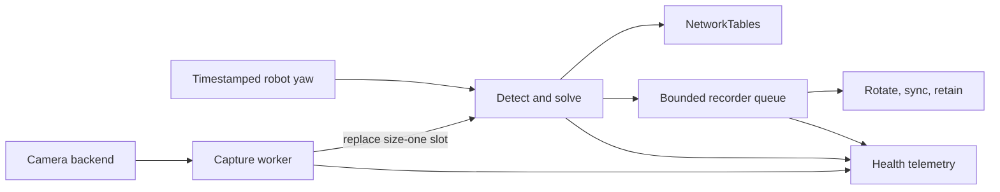

# Northstar Vision

`northstar-vision` is an alpha AprilTag 36h11 service for FRC-style coprocessors. It keeps camera latency bounded with
a latest-frame capture worker, detects tags with OpenCV, rejects weak field poses, publishes the upstream Northstar
NetworkTables packet, and can record complete frame results without putting disk I/O on the processing path.

Version 0.3.0 is an unreleased hardening release. The repository does not yet declare a redistribution license, so do
not publish its wheel or source archive until the owner chooses one.

## Install

Python 3.11 or newer and OpenCV 4.7 or newer are required.

```bash
python3 -m venv .venv
source .venv/bin/activate
python -m pip install .
```

Install RobotPy NetworkTables support on a coprocessor with:

```bash
python -m pip install '.[nt]'
```

The package provides four commands:

```text
northstar-vision      run the camera or replay service
northstar-calibrate   measure intrinsics from checkerboard images
northstar-layout      validate a WPILib AprilTag field layout
northstar-benchmark   measure an annotated image corpus and enforce gates
```

## Quick start

Validate a profile without opening a camera:

```bash
northstar-vision --list-profiles
northstar-vision --profile laptop --check-config
```

Run a laptop camera with a debug window, or replay a video/image directory once:

```bash
northstar-vision --profile laptop --show
northstar-vision --profile laptop --replay path/to/frames --output none
```

The `raspi` profile defaults to NetworkTables output:

```bash
northstar-vision --profile raspi
```

The bundled profiles are development examples. Their intrinsics, camera mount, and field layout are synthetic and
must not be used for robot localization.

## Runtime flow



Only the capture worker owns `VideoCapture`. If processing falls behind, a new frame replaces the stale slot instead
of growing a backlog. Failed opens and reads reconnect with bounded exponential backoff. Health includes captured,
delivered, overwritten, disconnect, reconnect, requested-property, negotiated-property, backend, FourCC, and shutdown
counters. A negotiated resolution that does not match the calibration is fatal.

Some OpenCV camera backends can block inside their native `read()` implementation. Shutdown remains bounded from the
caller's perspective and reports a timed-out worker, but Python cannot forcibly interrupt that native call; validate
the chosen V4L2/backend behavior on the target camera.

## Production calibration and field layout

Capture checkerboard photographs at the exact deployed resolution, focus, and lens settings. Use varied positions and
angles, then create a versioned measured artifact:

```bash
northstar-calibrate calibration-images/ \
  --output deploy/camera-calibration.json \
  --columns 9 --rows 6 --square-size-m 0.024 \
  --minimum-views 12
```

Validate the official WPILib layout and record its authoritative source:

```bash
northstar-layout deploy/field-layout.json \
  --official-source "WPILib official season layout" \
  --require-production \
  --report deploy/field-layout-report.json
```

Reference both artifacts from an external profile using paths relative to that profile:

```json
{
  "schema_version": 1,
  "name": "competition-camera",
  "device_id": "northstar_0",
  "platform": "raspberry_pi",
  "production": true,
  "camera": {
    "id": 0,
    "width": 1280,
    "height": 720,
    "fps": 30,
    "buffer_size": 1,
    "calibration": {"file": "camera-calibration.json"},
    "robot_to_camera": {
      "translation_m": [0.25, 0.0, 0.35],
      "rotation_rpy_rad": [0.0, 0.0, 0.0]
    }
  },
  "tag_size_m": 0.1651,
  "tag_layout": {
    "wpilib_json": "field-layout.json",
    "provenance": {"kind": "official", "source": "WPILib official season layout"}
  },
  "detection": {},
  "output": {"mode": "nt", "nt_server": "10.0.0.2"}
}
```

Strict parsing rejects unknown fields, duplicate tag IDs, invalid matrices, mismatched calibration resolution, and
invalid thresholds. A `production: true` profile additionally requires measured calibration provenance with view/error
metrics and official layout provenance with field dimensions.

All field and mounting transforms use WPILib axes: +X forward, +Y left, +Z up, and positive yaw counter-clockwise from
above. `camera.robot_to_camera` is the camera pose in the robot frame. The tag face lies in local Y/Z and local +X is
its face normal.

The corner convention matches official AprilRobotics/FRC artwork and upstream Northstar. OpenCV's
`generateImageMarker()` produces the equivalent dictionary image rotated 180 degrees relative to that artwork; rotate
generated fixtures before validating field transforms.

## Pose quality

Single-tag localization preserves both IPPE ambiguity candidates and suppresses the field pose if either candidate
fails reprojection or physical-bound checks. Multi-tag solving uses RANSAC when at least three tags are available,
falls back to a physically valid general PnP solve, removes high-residual tag outliers iteratively, and validates field
and camera-height bounds.

JSONL output records attempted, accepted, and rejected tag IDs, per-tag and overall RMS reprojection error, RANSAC use,
iterations, and the final rejection reason. Raw image/tag-angle observations remain available even when a field pose is
rejected. The existing `confidence` value is only a display heuristic; pose acceptance does not use it.

## Outputs

### NetworkTables

The Raspberry Pi profile publishes to `/<device_id>/output` and uses the upstream Northstar topic names. The
`observations` array is timestamped in NetworkTables' synchronized monotonic time base, translated from the frame's
local receive time, and contains:

1. Pose count/type: `0` for none, `1` for one multi-tag pose, `2` for two ambiguous single-tag poses.
2. Eight values per pose: reprojection error, XYZ, quaternion WXYZ.
3. Ten values per detected tag: ID, eight undistorted corner angles in radians, distance in meters.

Additional `fps_apriltags`, `latency_ms`, and `health` topics provide runtime telemetry. A one-tag field estimate keeps
both IPPE solutions when both satisfy the configured reprojection limit so the robot can disambiguate using its current
heading. If either candidate fails, the global single-tag field pose is suppressed while the tag-angle record remains;
the upstream packet has no safe one-candidate single-tag discriminator. A multi-tag estimate is only produced from at
least two unique known tags.

### JSONL

JSONL is self-describing and includes image corners, both per-tag IPPE candidates, global camera-pose candidates,
tag-angle data, trig poses, quality values, and stage timing. Choose its destination explicitly when useful:

```bash
northstar-vision --profile laptop --output jsonl --output-path recordings/run.jsonl
```

Writes are buffered and flushed periodically instead of forcing an SD-card flush for every frame. Rotation and
retention are not implemented yet, so long-running deployments should prefer NetworkTables or `--output none`.

## Detection and performance

The optional skip-scan prefilter samples the image, rejects flat frames, detects on a small set of merged regions, and
falls back to full-frame detection for busy scenes. It never decodes a tag itself. It is disabled in the bundled
profiles because the optimized full-frame path is faster in the current laptop benchmark; enable it only after replay
testing on the target camera and Raspberry Pi. Use `--enable-skip-scan` for that experiment. To force the full-frame
path during comparisons:

```bash
northstar-vision --profile laptop --disable-skip-scan
```

The hot path avoids deprecated ArUco functions, repeated camera-matrix inversion, redundant full-frame contrast scans,
and per-frame JSONL flushes. Health output separates acquisition wait, post-receive processing, frame age, detection,
solve, and previous-publish timing.

## Development

```bash
python -m pip install -e '.[dev,nt]'
ruff format --check .
ruff check .
pytest --cov=northstar_vision
python -m build
```

The earlier occlusion-tolerant detector remains in the source repository under `experiments/occlusion_detector/` as
unsupported research code; it is not included in wheels or source distributions. Its legacy camera demo, benchmark
launcher, fallback test runner, and runtime re-export were removed from the supported package surface.

## Current limitations

- Live capture is still sequential; a bounded latest-frame capture worker and automatic camera reconnect are planned.
- `--robot-yaw` is static for a run. Production trig localization should ingest timestamped robot orientation.
- Pose rejection uses reprojection error and cheirality, but does not yet use multi-tag RANSAC or field-bound checks.
- The repository does not yet declare a redistribution license; choose one before publishing a package.
