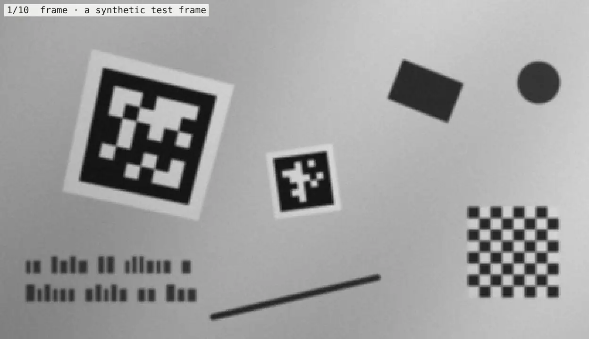

# How NAPA works

Upstream AprilTag processes the whole frame before it looks for tags. It thresholds every pixel, segments the image
into regions, and fits a quadrilateral to every region's outline. NAPA reverses the order. It finds likely tags on
a sparse grid first, skips anything without contrast, and does full-resolution work only on the tags themselves.

*One synthetic frame, stage by stage, at `min_tag_px=32`. Every overlay is computed from the frame by a port of
NAPA's pipeline.*

## 1. Sample a sparse grid

A tag36h11 tag is 8 cells across, and its black border is one cell wide. NAPA reads only the pixels on a grid
spaced three quarters of the smallest cell apart. That always puts a sample in the dark core of the border, even
when blur greys the cell's edges. At the default minimum tag size of 22 px, the grid takes every other pixel in
each direction, one pixel in four. At 32 px it takes every third pixel, one in nine.

Larger tags are found on coarser grids, at 2x, 4x, 8x, and up. Each coarser grid is built from the one before it
rather than from the image, and together they add about a third to the sampling cost. Each grid covers a band of
tag sizes. The bands overlap, so a blurred or tilted tag can surface on more than one. A large, low-contrast tag
needs a grid fine enough to keep its one-cell white margin from falling between samples, or it merges with a dark
background.

The caller's pixels are never modified, and no view of them is kept after the call.

## 2. Skip regions without contrast

The grid is divided into small tiles. NAPA records each tile's darkest and brightest sample. A tile without
contrast cannot contain a tag's edge, so it is skipped without thresholding or segmenting.

The contrast a tile needs rises with sensor noise. NAPA measures that noise from the frame itself, region by
region, so a noisy or textured patch does not hide tags elsewhere in the frame. On a very noisy frame, each sample
averages the pixels around it. When the grid samples every pixel, as it does at a small `min_tag_px`, averaging
would blur away tiny borders, so NAPA keeps the original pixels and demands more contrast instead. The next,
coarser grid is averaged, and finds the low-contrast tags.

## 3. Group dark samples into blobs

Every pass over the grid works on whole rows with vector instructions. One SSE2 or NEON instruction compares 16
samples with their thresholds and packs the results into a bitmask. Runs of dark samples come out of the masks
with one count-trailing-zeros instruction per run. Union-find then joins runs that touch into blobs. The cost
follows the number of runs, not the number of dark pixels. Gathering every other pixel uses an SSE2 mask-and-pack
or NEON's de-interleaving load. Every third pixel uses a byte shuffle (SSSE3, chosen at run time) or NEON's
de-interleaving load.

Two contact cases get special handling:

- A point contact can join a tag to a neighbouring dark shape, as happens on calibration boards. Before joining
  runs that touch only diagonally, NAPA checks a small neighbourhood in the sampled grid. It keeps the runs
  separate when both corners have filled dark support and the samples between them are light. Contacts without
  that support stay joined, as do all overlapping runs. The check adds no image pass and no extra buffer. Splitting
  the harder contacts is the opt-in [`split_touching`](detection.md#calibration-boards-and-touching-tags) path.
- A fine grid can preserve the outline of a large tag that merges with its background on a coarser grid. NAPA keeps
  those extra outlines, checks them against the tags already decoded, and fits only the ones that are new.

On the finest grid, NAPA also keeps slightly smaller whole outlines that fall below the usual size band. It fits
them after the established proposals and accepts them only when the payload matches a code exactly, with no bit
correction. Sparse sampling can also leave three corners of a small outline's bounding box plus a fourth point
along an edge or inside it. NAPA completes that missing corner only when the other three are distinct box corners
and the result has the expected winding. That completed corner is a seed for the edge fit, not a measured corner.
The fitted border and an exact payload must still pass.

## 4. Reject non-tags before measuring them

Each blob of plausible size gets a rough quadrilateral from its extreme points. A blob darker overall than any real
code allows is dropped at once. Every tag36h11 code has at least 10 white cells.

A rotated, foreshortened tag can occupy a small part of its axis-aligned box. For those shapes NAPA also tests the
quadrilateral's area, perimeter, and dark-sample density. Tags admitted by this extra test wait until the ordinary
path finishes, then append without displacing earlier results. Optional split pieces still come last. Short-code
families, which match clutter more often, must show a complete dark border on this path.

Each survivor then goes through four steps:

1. Fit each side to its edge at full resolution.
2. Decode at once with a loose tolerance, reading the border first. Text, texture, and checkerboards are rejected
   here, before any expensive refinement.
3. Refine each side from coarse to fine, then measure the edge every 1.5 px along it. Each measurement is the
   centre of the edge's gradient, which locates an isolated symmetric edge exactly when pixels average the light
   falling on them. Where blur is wider than about half a cell, NAPA instead locates the edge where the image
   crosses halfway between the black and white on either side. It takes that crossing from where the profile's
   area balances over a pixel each way, so the result does not depend on how the edge falls between pixels. That
   matters most on tags that sit nearly upright in the frame.
4. Intersect the four fitted lines to get the corners, and decode the payload.

Each side's line fit drops samples that disagree with the rest of the edge, so a short obstruction along a side
does not pull the corners off.

### Corners that need extra work

A few shapes defeat a plain whole-side fit. NAPA handles each one, and keeps a fix only if the tag still decodes
to the same ID with no more corrected bits:

- **Bowed sides.** Through a wide lens, a tag's sides bow, and a whole-side fit can miss a corner. A sharp corner
  magnifies the miss. NAPA re-finds those corners from short runs of the two edges beside them. Corners whose
  edges already match the fitted sides are left alone, and very strongly bowed tags keep the whole-side fit. The
  dense fit can also try a quadratic curve per side when it explains much more of the residual than a line does.
- **Sides cut by the frame.** A cut side has no samples at its true end. Near the frame, NAPA first looks for one
  radial lens term that straightens all four sides together, so the fully seen sides supply the cut side's bow.
  Failing that, it trusts a curve only when a corner clear of the frame shows the same bow. Corners beyond the
  frame are never re-fitted.
- **A grey quiet zone on a bright background.** The margin reads as dark, so the first outline is the margin's. If
  decoding fails, NAPA retries on the outline's inner eight tenths, where the black square would be.
- **A side fitted one cell out.** The side landed on the margin's outer edge, which shows up as border cells that
  read white. NAPA moves that side in by a cell and refits it.
- **Clipped exposure.** Clipping shrinks every black region by the same amount. The black border must be exactly
  one cell wide, so NAPA measures the shrinkage on the tag itself and undoes it. The check also reads the
  payload's own edges. If only the border's inner edge is off, as on artwork whose border is not exactly one cell
  wide, the correction fades out.
- **Uneven light across a wide blur ramp.** The final fit estimates local black and white levels from the border
  and quiet zone. For normal print, an alternative outline follows the quiet zone's illumination slope while
  keeping the fitted midpoint level, because thin border samples can mix with the payload under blur. Inverted
  families keep independent black and white planes. The alternative reuses the measured edge profiles, and it must
  decode the same ID. If the ordinary outline fails to decode, NAPA refits this alternative as a recovery path. An
  invalid model, or a failed alternative, leaves a valid detection untouched.

Blur moves a tag's apparent edges, and the camera's tone curve decides which way. After decoding, NAPA compares
the tag's picture with its code to measure the blur along each axis and how curved the tone is. On a clearly
gamma-curved image it moves each side back by a calculated amount. A heavily blurred tag on a straight tone curve
reads slightly large instead, and gets a smaller correction of its own. Several corrections fade in near their
limits rather than switching, so noise moves a tag near a limit a little instead of flipping its corners between
two answers. Sharp tags, tags at the frame's edge, and tags on boards are left alone. Motion blur remains the
hardest case. On gamma-encoded images, a blur streak longer than about half a cell can still move a corner by a
pixel or more. The opt-in [`camera_gamma`](detection.md#camera-gamma) and
[`align_corners`](detection.md#corner-alignment) settings go further, using a gamma you supply or a per-tag
alignment.

On coarser grids, NAPA retries an outline when both initial decodes fail and its first fit rejected samples. The
retry weights larger gradients more strongly, reuses the original profile points, and demands an exact payload
match before refinement and an exact final match to the same ID. Successful retries wait until the established
detections finish, so they cannot displace them.

Duplicates across sampling levels are removed in two steps. NAPA first checks centre distances, then whether a
proposed centre lies inside an outline that already decoded. Nearby tags with disjoint outlines stay separate even
when strongly foreshortened, including two physical copies of the same ID.

## 5. Look up the ID

A tag36h11 payload has 36 bits. Checking it means comparing against 587 codes in 4 rotations while allowing up to
3 wrong bits. Any code within 3 bits of the payload must match at least one of its four 9-bit blocks exactly. NAPA
looks those blocks up in a table and compares only the few codes that share one, instead of all 2,348.

## Obstructions

NAPA corrects up to 3 wrong payload bits. Upstream AprilTag defaults to 2. A hand, cable, or glare spot over part
of a tag therefore often still decodes. A third corrected bit is accepted only when the three wrong cells touch, as
they do under a real obstruction. A random pattern that happens to fall within three bits of a code has its errors
scattered, so the rule keeps chance matches out.

In the benchmark's obstruction sweep (864 tags with 0 to 40% of the black square covered by a white or grey patch),
NAPA found 357. WPILib's AprilTag at decimate 2 found 330.

Every AprilTag detector finds the black border before it reads any bits. None of them can find a tag whose border
is hidden across a whole side or around a corner.

## Limits

- **Tag size.** Tags smaller than `min_tag_px` may be missed. A steeply tilted tag counts by its narrowest side.
- **Quiet zone.** Tags need the white margin that printed tags have. A tag whose margin runs straight into dark,
  busy texture can merge with it and be missed. Steep tilt makes this likelier, because it narrows the margin.
- **Contrast.** Tags with less than `min_contrast` grey levels between black and white are skipped.
- **Motion blur.** Blur longer than one cell, an eighth of the tag, remains hard on corner accuracy. In the
  published comparison, NAPA's worst corner in the motion-blur scene was 3.4 px off. Refinement since then reduces
  that bias in tested cases, but changing illumination, clipping, and lens distortion can still move corners. A
  successful decode is not proof of accurate geometry. Check corner and pose accuracy on your own camera.

[Tuning](detection.md#tuning) covers `min_tag_px` and `min_contrast`.
